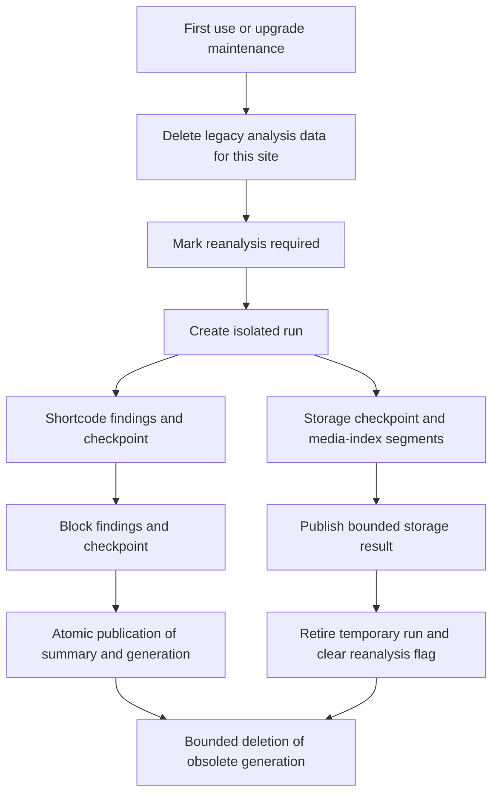

# Runtime state and scheduler

## Namespaces

The plugin's technical keys follow three conventions:

| Prefix | Use |
| --- | --- |
| `rrze_msm_` | Network options, site meta, site options, transients, locks, and Cron hooks for runtime logic |
| `rrze_msm_run_` / `rrze_msm_refresh_` | Executing or continuing Cron hooks |
| `rrze_multisite_manager_` | Dashboard cache and admin-post and network-admin actions |

Global plugin configuration is stored as the network option `rrze-multisite-manager`. Its boolean `monitoring_show_local_analysis_request_notice` controls whether local administrators without a planned or saved storage or shortcode-and-block analysis see the corresponding request page under **Tools**; it defaults to disabled. Hook names and scheduling keys are centrally defined in `includes/Config.php`. Any change to these names always requires a migration or cleanup strategy for existing Cron entries.

## Cron operation

The plugin registers WordPress Cron events; it does not require visitor traffic to execute them. The production setup uses an external Cron service to trigger due WordPress events. Its cadence must be short enough for the intended continuation delays. A due timestamp is therefore the earliest execution time, not a guarantee that PHP starts at that exact second.

Do not delete or recreate individual continuation, composition, or watchdog events merely because a site batch already shows 100 percent. The Monitoring page distinguishes the collection phase from the following composition phase and displays the next composition-related event. Manual actions should be limited to an explicit reset after a reported final failure or to the documented task-removal tools.

## Central dashboard metrics

| Element | Name |
| --- | --- |
| Recurring hook | `rrze_msm_refresh_dashboard_metrics` |
| Composition hook | `rrze_msm_compose_dashboard_metrics` |
| Composition watchdog hook | `rrze_msm_watch_dashboard_metrics_composition` |
| Schedule key | `rrze_msm_dashboard_metrics_cycle` |
| Continuation argument | `['rrze_msm_dashboard_metrics_batch' => true]` |
| Enablement | Network option `rrze_msm_dashboard_metrics_scheduling_enabled` |
| Cache | Network option `rrze_multisite_manager_dashboard_metrics_v7_<network-id>` |
| Batch progress | `rrze_msm_dashboard_metrics_batch_offset`, `rrze_msm_dashboard_metrics_batch_total`, `rrze_msm_dashboard_metrics_batch_state` |
| Per-batch intermediate state | Network option `rrze_msm_dashboard_metrics_batch_partial_<run-hash>_<offset>` |
| Refresh lock | `rrze_msm_dashboard_metrics_refresh_lock_state`, TTL 900 seconds |
| Composition lock | `rrze_msm_dashboard_metrics_composition_lock`, TTL 900 seconds |
| Dirty marker | `rrze_msm_dashboard_metrics_dirty` |

Detail-cache maintenance runs hourly on the central network site through `rrze_msm_maintain_detail_cache`. It deletes at most 100 value keys per invocation from obsolete detail-cache versions, together with their matching timeout rows, and schedules one bounded continuation when further keys remain.

`MetricsImplementationService` creates the record, `DashboardMetricsBatchService` processes the site loop, and `DashboardMetricsRefreshService` manages cache, batch state, intermediate states, and locks. Each batch writes only its bounded intermediate state. Once all batches finish, the composition hook merges all intermediate states, publishes the complete cache record, and removes intermediate states.

The master batch state records the run ID, offsets, phase, composition attempt count, and any composition error; it does not contain the growing aggregate. The `composing` phase prevents another metrics run from starting. The composition event is scheduled after at least five seconds; the watchdog is scheduled after the 900-second lock TTL, reschedules a composition that no longer holds a valid lock, and marks the run failed after three attempts. Successful and finally failed runs remove their own composition and watchdog events. A failed composition stays visible as stale state and requires a reset; reset removes all intermediate states, locks, and scheduled composition events.

After a completed run, transient batch progress is intentionally reset. The Monitoring progress is derived from the published cache in that state and therefore displays the completed `site_count / site_count` rather than `0 / site_count`.

The cache has its own data-version number. It is checked when read and schedules a new bounded run after a version change. Old transient cache versions with the prefix `rrze_multisite_manager_dashboard_metrics_v1_` through `_v6_` are cleaned up only for compatibility.

## Availability monitoring

| Element | Name |
| --- | --- |
| Hook | `rrze_msm_check_site_availability` |
| Default schedule key | `rrze_msm_every_six_hours` |
| Continuation argument | `['rrze_msm_monitoring_batch' => true]` |
| Enablement | `rrze_msm_monitoring_scheduling_enabled` |
| Run state | `rrze_msm_monitoring_run_state` |
| Batch progress | `rrze_msm_monitoring_batch_offset`, `rrze_msm_monitoring_batch_total` |
| Log | `rrze_msm_monitoring_run_log` |
| Lock | `rrze_msm_monitoring_lock_state`, fallback transient `rrze_msm_monitoring_lock`, TTL 900 seconds |

`MonitoringService` registers the hook on `init` only in the main site's Cron context. A continuation event is scheduled with a minimum five-second delay. HTTP checks use the WordPress HTTP API; static defaults are five sites per monitoring batch, a 45-second request budget, a four-second HTTP timeout, and a two-second fallback timeout.

PHP's native DNS functions (`dns_get_record()` and `checkdnsrr()`) have no timeout configurable per call. The plugin therefore no longer starts a DNS check when fewer than five seconds remain in the batch time budget. It stores the status as `unknown`; this does not count as a DNS failure and is checked again in the next regular run. This safeguard cannot prevent an already-started DNS call from blocking.

### Server operation: DNS timeouts

For large production networks, the DNS resolver of the PHP/Cron host must be bounded and available. A local cached resolver such as Unbound or systemd-resolved is recommended. Its upstream resolvers should use short operationally agreed time limits and a limited number of retries; on glibc-based hosts this can, for example, use `options timeout:1 attempts:1` in resolver configuration. The exact configuration depends on the operating system, container, and resolver and must be agreed with the infrastructure team because it affects all host processes.

If a guaranteed upper bound per DNS request is required, resolution must not occur in the WordPress/PHP process. It must run through a separately monitored worker or an operator-controlled DNS-over-HTTPS endpoint with a fixed HTTP timeout. Public DNS-over-HTTPS services are unsuitable for monitoring because they disclose all monitored domains to third parties.

The following site-meta keys are written per site: `rrze_msm_operational_status`, `rrze_msm_operational_status_source`, `rrze_msm_previous_operational_status`, `rrze_msm_operational_status_changed_at`, `rrze_msm_dns_status`, `rrze_msm_dns_status_detail`, `rrze_msm_http_status`, `rrze_msm_http_status_detail`, `rrze_msm_http_status_code`, `rrze_msm_last_availability_check`, `rrze_msm_last_dns_ok_at`, `rrze_msm_last_http_ok_at`, `rrze_msm_last_dns_error_at`, `rrze_msm_last_http_error_at`, `rrze_msm_dns_failure_count`, `rrze_msm_http_failure_count`, `rrze_msm_monitoring_note`, and `rrze_msm_monitoring_history`.

## Central analysis tables

Four InnoDB tables use `$wpdb->base_prefix`, independently of the currently selected website. They are created or upgraded by `AnalysisStore::install()` during plugin activation and whenever the network option `rrze_msm_analysis_schema` differs from `AnalysisStore::SCHEMA_VERSION`. `dbDelta()` creates missing columns; `verifySchema()` then requires the InnoDB engine and every listed column before the version is saved. A failed validation leaves the schema version unchanged, so a later request retries the repair.

| Table suffix (after `rrze_msm_analysis_`) | Contents |
| --- | --- |
| `runs` | Run identity, network/site scope, phase orchestration, bounded storage checkpoints and completed content-analysis summaries |
| `shortcodes` | Incremental shortcode findings and the separate shortcode checkpoint (`entry_key = checkpoint`, `post_id = 0`) |
| `blocks` | Incremental block findings and the separate block checkpoint (`entry_key = checkpoint`, `post_id = 0`) |
| `mediaindex` | Bounded attachment-path segments (`00`–`ff`) and media-usage ID segments (`u00`–`uff`) |

The base prefix means that one physical table set serves every network that shares the WordPress database prefix. Every query is therefore scoped by `network_id`, `blog_id`, and, where applicable, `run_id`. Table names do not change with `switch_to_blog()`. Only plugin-owned table identifiers are accepted; existing dashboard capability checks protect result pages.

### `{$wpdb->base_prefix}rrze_msm_analysis_runs`

| Column | SQL type / default | Purpose |
| --- | --- | --- |
| `id` | `bigint(20) unsigned`, auto increment | Technical primary key |
| `network_id` | `bigint(20) unsigned` | Network scope |
| `blog_id` | `bigint(20) unsigned` | Website scope |
| `run_id` | `varchar(36)` | UUID of one analysis generation |
| `slot` | `varchar(191)` | Active-run slot, for example `content`, `storage_base`, or `storage_media`; an obsolete/completed run uses its UUID as slot |
| `kind` | `varchar(24)` | `content`, `storage_base`, `storage_orphan`, `storage_metadata`, or `mediaindex` |
| `status` | `varchar(24)`, default `running` | `running`, `complete`, or `obsolete` |
| `payload` | `longtext` | Bounded serialized checkpoint; empty after content publication |
| `summary` | `text` | Bounded serialized completed-content summary |
| `updated_at` | `bigint(20) unsigned` | Unix timestamp of the most recent write |
| `expires_at` | `bigint(20) unsigned` | Unix expiry; `0` retains the current completed content generation |

Indexes are `PRIMARY KEY (id)`, unique `slot (network_id, blog_id, slot)`, unique `run (network_id, blog_id, run_id)`, `completed (network_id, blog_id, kind, status, id)`, and `expiry (network_id, expires_at, id)`.

### `{$wpdb->base_prefix}rrze_msm_analysis_shortcodes` and `..._blocks`

The two tables have the same schema and are deliberately separate. Shortcode and block findings, their counters, and their phase checkpoints cannot grow into each other.

| Column | SQL type / default | Purpose |
| --- | --- | --- |
| `id` | `bigint(20) unsigned`, auto increment | Technical primary key |
| `network_id`, `blog_id`, `run_id` | `bigint(20) unsigned`, `bigint(20) unsigned`, `varchar(36)` | Network, website, and generation scope |
| `entry_key` | `varchar(64)` | SHA-256 identity for one finding; `checkpoint` for the phase checkpoint |
| `name` | `varchar(191)`, default empty | Shortcode or block name |
| `post_id` | `bigint(20) unsigned`, default `0` | Source post; checkpoints use `0` |
| `payload` | `longtext` | One bounded serialized finding or checkpoint |
| `payload_bytes` | `int(10) unsigned` | Serialized payload size for operational inspection |
| `registered` | `tinyint(1)`, default `1` | Whether the shortcode/block is registered |
| `provider`, `category`, `origin` | `varchar(191)`, default empty | Bounded display and filtering metadata |
| `description` | `varchar(1024)`, default empty | Bounded description |

Indexes are `PRIMARY KEY (id)`, unique `entry (network_id, blog_id, run_id, entry_key)`, and `names (network_id, blog_id, run_id, name, id)`. The latter supports SQL-side filtering, sorting, and pagination before a payload is decoded.

### `{$wpdb->base_prefix}rrze_msm_analysis_mediaindex`

| Column | SQL type / default | Purpose |
| --- | --- | --- |
| `id` | `bigint(20) unsigned`, auto increment | Technical primary key |
| `network_id`, `blog_id`, `run_id` | `bigint(20) unsigned`, `bigint(20) unsigned`, `varchar(36)` | Network, website, and generation scope |
| `entry_key` | `varchar(64)` | Segment key, for example a hexadecimal path bucket or `u00`–`uff` for used attachment IDs |
| `name` | `varchar(191)`, default empty | Reserved bounded segment label |
| `post_id` | `bigint(20) unsigned`, default `0` | Reserved source identifier |
| `payload` | `longtext` | One bounded serialized index segment |
| `payload_bytes` | `int(10) unsigned` | Serialized segment size |

Indexes are `PRIMARY KEY (id)`, unique `entry (network_id, blog_id, run_id, entry_key)`, and `names (network_id, blog_id, run_id, name, id)`. This table deliberately has no shortcode/block registration metadata.

The shortcode and block phases share a generation, but their findings, cursors and counters remain in their own tables. Findings and checkpoints commit in one transaction. Publication replaces the retained completed generation atomically; a failed publication retains the previous result. Old generations are marked obsolete and removed in bounded batches. Removing a website's analysis marks every generation of that analysis obsolete immediately, hides it from all result views and schedules the same bounded deletion. Status and scheduling options remain small. Monitoring reads only the completed summary, never the findings. Detail views query at most 50 findings plus one continuation probe, applying filtering and sorting in SQL. Grouped locations describe the current page only.

Checkpoints expire explicitly after 24 hours of inactivity; media-index runs have a seven-day expiry. No running analysis depends on an evictable transient. Storage states are limited to 1 MiB; each content checkpoint row to 8 KiB. Findings have an 8-KiB row limit, a 256-KiB pending-buffer limit, and a 1-MiB cumulative payload budget **per phase**, plus the existing configured entry limit. Input content and individual meta values are size-gated in SQL at 256 KiB. Post metadata is traversed in pages of ten with a resumable meta cursor. Display strings are bounded before persistence; truncation or omitted input is explicitly reported as incomplete results.

Schema version: network option `rrze_msm_analysis_schema` (currently 3). The independent `AnalysisStore::DATA_VERSION` stays at 1, so additive schema repairs do not repeat the destructive legacy-data migration. Site upgrade marker: non-autoloaded option `rrze_msm_analysis_storage_version`. The upgrade intentionally discards all previous analysis results and working states, without reading their large payloads. Network cursor `rrze_msm_analysis_upgrade_cursor` traverses ten sites per maintenance invocation (`-1` means done). The same per-site preparation runs before a site's first new analysis. It preserves schedules/settings and sets `rrze_msm_analysis_reanalysis` flags for previously analysed sites. Successful new storage/content results clear their respective flag. Existing live-worker protection applies when clearing legacy reservations. MySQL connection-scoped named locks serialize schema creation and each site's upgrade; failed writes do not mark the site migrated.

Maintenance hook `rrze_msm_analysis_maintenance` runs on the network's main site, first after one minute and then hourly. Continuations with `[true]` run after at least one minute while work remains. It deletes at most 250 legacy network transient rows and handles at most ten expired runs per invocation, deleting at most 250 child rows per table/run before deleting an empty run. Website deletion marks its runs obsolete. The existing full-data cleanup also removes central data in network-scoped batches. Completed current content results have no expiry; the last successful result is retained until a replacement or explicit cleanup.

On interactive network deactivation, the plugin first asks whether the central analysis tables should be retained or deleted. Both choices remove every plugin-owned Cron hook from every website. Deleting tables is an explicit, nonce-protected choice; non-interactive deactivation such as WP-CLI or an update keeps the tables.

Known legacy external-cache keys are invalidated in bulk. Old versioned keys that exist only in an external cache and cannot be enumerated expire under their original cache policy; they are never read by the new implementation. The plugin never flushes unrelated cache contents.

## Storage analysis

| Element | Name |
| --- | --- |
| Individual-analysis hook | `rrze_msm_run_site_storage_analysis` |
| Small collective-batch hook | `rrze_msm_run_site_storage_analysis_batch` |
| Medium collective-batch hook | `rrze_msm_run_site_storage_analysis_medium_batch` |
| Slice-continuation hook | `rrze_msm_continue_storage_analysis` |
| Central FIFO queue | Network option `rrze_msm_storage_analysis_continuation_queue`, site IDs mapped to run IDs |
| Frequency migration | `rrze_msm_reschedule_storage_analysis_frequency` |
| Obsolete removal hook | `rrze_msm_remove_storage_analysis_tasks` |
| Small-batch continuation argument | `['rrze_msm_storage_analysis_batch' => true]` |
| Medium-batch continuation argument | `['rrze_msm_storage_analysis_medium_batch' => true]` |
| Site lock | `rrze_msm_storage_analysis_lock_<site-id>` |
| Small/medium collective-batch locks | `rrze_msm_storage_analysis_batch_lock`, `rrze_msm_storage_analysis_medium_batch_lock` |
| Network-wide execution slots | `rrze_msm_storage_analysis_run_slots` |
| Lock for slot/queue updates | Non-autoloaded main-site option `rrze_msm_storage_analysis_run_slots_lock`; token and 60-second lease |

Assignment modes are `small-batch`, `medium-batch`, and `site`. The first two have separate central Cron hooks, cursors and site lists. A successful completed run is assigned by media count **or** active runtime: exceeding either small threshold moves it to medium, exceeding either medium threshold moves it to an individual task. Assignment and progress data are network options, including `rrze_msm_storage_analysis_assignments`, `rrze_msm_storage_analysis_batch_site_ids`, `rrze_msm_storage_analysis_medium_batch_site_ids`, `rrze_msm_storage_analysis_batch_last_site_id`, `rrze_msm_storage_analysis_medium_batch_last_site_id`, `rrze_msm_storage_analysis_schedule_initialization_state`, and `rrze_msm_storage_analysis_frequency_reschedule_state`. The persistent result is a non-autoloaded site option in `rrze_msm_site_storage_analysis_result`; summary metadata is in `rrze_msm_site_storage_analysis_result_meta`. Both storage and media-metadata results have a hard serialized 2-MiB cap; summary metadata has a 16-KiB cap. All variable lists and strings are compacted before serialization, failures are reported and legacy oversized values are replaced through size-gated SQL reads.

Storage runtime key strings remain internal adapter identifiers: `rrze_msm_site_storage_analysis_base_state_resumable_v2_<site-id>`, `rrze_msm_site_storage_analysis_orphan_state_resumable_v2_<site-id>`, and `rrze_msm_site_storage_attachment_index_bucket_resumable_v2_<site-id>_<hex-bucket>`. They are **not transient storage locations**. `StorageRuntimeStore` maps them to the central run slots `storage_base`, `storage_orphan`, and `storage_media`; media metadata uses `storage_metadata`. Detail-cache invalidation does not lose progress. Base state holds bounded attachment/index/statistics cursors, directory cursors, accumulated statistics and the selected page/segment-write limits. Referenced attachment IDs live in media-index segments, not in an ever-growing checkpoint array.

A scheduled slice keeps processing until its five-second soft budget or memory budget is reached. A 1,000-step emergency cap prevents a faulty step from looping indefinitely; the ordinary stop is the time or memory budget. The incremental PHP memory budget is 32 MiB, with at least 16 MiB below 70% of PHP's configured memory limit. Central index reads/writes do not prime the WordPress object cache. The scanner keeps only its bounded in-process bucket cache. Blocking calls may exceed the soft budget. Site, batch and execution-slot leases last 120 seconds; the slot/queue mutex uses the unique main-site `wp_options.option_name` index and a token to protect release.

The first batch of a slice runs even when reserving the next Cron event consumes the soft time budget. The scheduler emits `rrze.log.info` diagnostics with `event`, `site_id`, and `run_id`: `dispatched`, `slice_started`, `next_slice_reserved`, sampled `batch_started`/`batch_completed`, and `slice_yielded`. Batch samples are logged for the first and every sixteenth step, plus phase completion; the yielded event contains the final progress. A `batch_started` without `batch_completed` narrows a stalled run to the scanner or a fatal interruption. Completed base batches include the last attachment ID and pending index-bucket count in `progress`; no file paths or URLs are logged. These continuation diagnostics are emitted independently of general info-logging settings.

Batch numbers in those diagnostics start again at one for each Cron slice. The monitoring table displays the last indexed attachment ID and outstanding index-segment count while the file index is active. A stable attachment ID is expected while segments from the current attachment page are being written; the pending count should fall before the next attachment page is read.

The scheduler status stores `run_id`, `run_phase` and `active_duration_seconds`. The configured profile-specific runtime limit counts active processing, not waiting between Cron requests; a seven-day wall-clock limit also bounds abandoned runs. Individual tasks permit a configured limit up to twelve hours. Index segments use a seven-day TTL; base/orphan state and idle index reservations expire after 24 hours. Expired reservations delete their segments without loading payloads. Completion, handled errors and explicit aborts clear temporary state. The next event is reserved before processing, and queue items remain until completion, so an interrupted PHP process does not silently lose its continuation. Continuation queue entries are checked against the current run ID and assignment before executing; task removal also removes the continuation hook and queue. A brief mutex collision retries through the existing individual/targeted collective Cron path instead of discarding saved progress.

Resource contention is recorded on the scheduler status without marking a phase as started before a successful slice. The capacity message names the site IDs holding network-wide temporary-index reservations. An individual assignment retries through a single event on its own site after about one minute, without occupying the central continuation queue; Monitoring displays that retry timestamp. A successful retry clears the waiting reason. If contention persists for more than 24 hours, the run stops with an explicit final error instead of continuing to promise a retry.
Continuation hooks left in a subsite's Cron table by an older installation switch to the network's main site before processing the central queue. Normal scheduler updates retain the run identity; the central-storage migration is an explicit exception and requires fresh analyses.
The storage monitoring row shows the current wait reason and the next scheduled continuation or individual retry. A site waiting behind other sites in an active small or medium shared batch is labelled **Current shared batch** instead of showing only the later regular cycle; that regular timestamp remains visible as the next regular cycle. A paused maintenance or schedule migration reschedules the continuation after one minute.

The `monitoring_storage_analysis_max_concurrent_runs` option limits concurrently executing storage slices across the network; its default and minimum are four and its hard maximum is eight, including previously saved values outside that range. Independent atomic main-site worker options cover browser and metadata requests too. The central continuation queue processes one website per invocation. Runtime helpers retain their old method signatures for compatibility, but the cache-version argument no longer changes active state keys. Legacy `rrze_msm_site_storage_analysis_v3_<cache-version>_<site-id>` result caches and `rrze_msm_site_storage_attachment_index_v2_<cache-version>_<site-id>` monolithic indexes are only relevant to compatibility cleanup.

Resource reservations use non-autoloaded main-site options `rrze_msm_storage_resource_slot_0` through `_7`, guarded by `rrze_msm_storage_resource_mutex`. Limits are 32 MiB per temporary index, 128 KiB per segment and 1 MiB per state. The active worker options are `rrze_msm_storage_worker_0` through `_7`. Tokens, host and PID prevent expiry alone from overbooking a still-blocked worker. Only verified stopped local processes or a reused non-threaded current PID without a live token can be reclaimed. Unverifiable remote/stale reservations fail closed and log once after 24 hours; operator verification is required before clearing them.

Hook `rrze_msm_storage_resource_maintenance` is registered on load but first scheduled hourly after explicit analysis activity. It deletes only owned runtime values/timeout keys in the current network, selecting at most 250 timeout keys per invocation without loading payloads. It also size-checks and repairs the three derived result options for at most 25 sites per invocation. Cursor `rrze_msm_storage_resource_maintenance_offset` tracks traversal; argument `[true]` schedules bounded continuations after at least 60 seconds. Old runtime formats are removed regardless of their old TTL; expired current-format values are removed even with an external object cache. Completed bounded results remain available. See [Storage analysis](storage-analysis.md) for caps, legacy reanalysis and operational limits.

## Shortcode and block analysis

| Element | Name |
| --- | --- |
| Individual-analysis hook | `rrze_msm_run_shortcode_block_analysis_site` |
| Collective-batch hook | `rrze_msm_run_shortcode_block_analysis_batch` |
| Legacy hook | `rrze_msm_run_shortcode_block_analysis` |
| Frequency migration | `rrze_msm_reschedule_shortcode_block_analysis_frequency` |
| Obsolete removal hook | `rrze_msm_remove_shortcode_block_analysis_tasks` |
| Batch continuation argument | `['rrze_msm_shortcode_block_batch' => true]` |
| Site lock | `rrze_msm_shortcode_block_analysis_lock_<site-id>` |

Scheduler data remains in network options, including `rrze_msm_shortcode_block_analysis_assignments`, `rrze_msm_shortcode_block_analysis_batch_site_ids`, `rrze_msm_shortcode_block_analysis_batch_offset`, `rrze_msm_shortcode_block_analysis_batch_lock`, and `rrze_msm_shortcode_block_analysis_schedule_initialization_state`. Small per-site status is stored in `rrze_msm_shortcode_block_analysis_status`. The old result/state options and state transient are removed on upgrade. See [Central analysis tables](#central-analysis-tables) for new persistence and limits.

A collective-batch site gets at most ten content sub-batches and 20 seconds per Cron request; an individual site gets at most twenty sub-batches and 60 seconds. Each checkpoint is persisted before reporting progress and scheduling the continuation. Missing individual continuations are recreated from durable state; a shared-batch site with no continuation or no progress for two hours fails and restarts fresh on its next regular run. Interrupted or expired generations are never published.

## Admin AJAX and maintenance

Schedule initialisation, task removal, and cleanup of old local central Cron entries are browser-driven AJAX batches. The hooks are `wp_ajax_rrze_msm_start_analysis_schedule_initialization`, `wp_ajax_rrze_msm_run_analysis_schedule_initialization_batch`, `wp_ajax_rrze_msm_start_analysis_task_removal`, `wp_ajax_rrze_msm_run_analysis_task_removal_batch`, `wp_ajax_rrze_msm_start_legacy_central_cron_cleanup`, and `wp_ajax_rrze_msm_run_legacy_central_cron_cleanup_batch`.

Task removal uses the respective state options `rrze_msm_storage_analysis_task_removal_state` and `rrze_msm_shortcode_block_analysis_task_removal_state`. Old local central Cron entries use `rrze_msm_legacy_central_cron_cleanup_state`. `NetworkCronCleanupQueue` adds `mode = ajax`, `run_id`, and a 15-minute lease to AJAX runs. An abandoned browser run is then marked as abandoned and does not permanently block new regular analysis tasks.

All AJAX and admin-post actions check capability and nonce. New technical actions must retain both checks and store their state in network options when they operate network-wide.

## External communication

`MonitoringService` sends DNS and HTTP requests to site domains registered in the multisite. HTTP requests use the WordPress HTTP API without authentication. Target, timeout, and error behaviour are described in Availability monitoring. Depending on the target domain, request metadata can leave local infrastructure.

Reverse image search is a user-initiated browser action: the link to TinEye passes the publicly reachable image URL as a search parameter. The plugin does not make a server-side request to TinEye and uses no API credentials.

## Browser state and cookies

The plugin uses neither `localStorage` nor `sessionStorage`. JavaScript in `src/js/rrze-multisite-manager.js` sets cookies with `Path=/` and `SameSite=Lax`:

| Cookie | Content | Lifetime |
| --- | --- | --- |
| `rrze_msm_color_mode` | Selected admin colour mode | 365 days |
| `rrze_msm_widget_order_<view>` | Individual widget order for a dashboard view | 365 days |

Cookie values contain no credentials. The widget order is additionally stored as user meta `rrze_msm_widget_orders` so that server-rendered order is retained independently of the browser.

### Analysis persistence diagnostics

Persistence failures include an operation identifier and safe error category in the saved monitoring error. Examples are `shortcodes-entry-write`, `blocks-counts`, `source-postmeta-read`, `payload-decode`, and `checkpoint-write`. Categories distinguish missing columns/tables, SQL syntax, encoding/size errors, lock conflicts and invalid data. `rrze.log.error` receives these fields and a fingerprint before transaction rollback can clear the database error. SQL text, raw database errors and analysis payloads are not logged by this diagnostic path. A category of `validation-failed` means there was no database error text; it must not be interpreted as a confirmed SQL failure.
