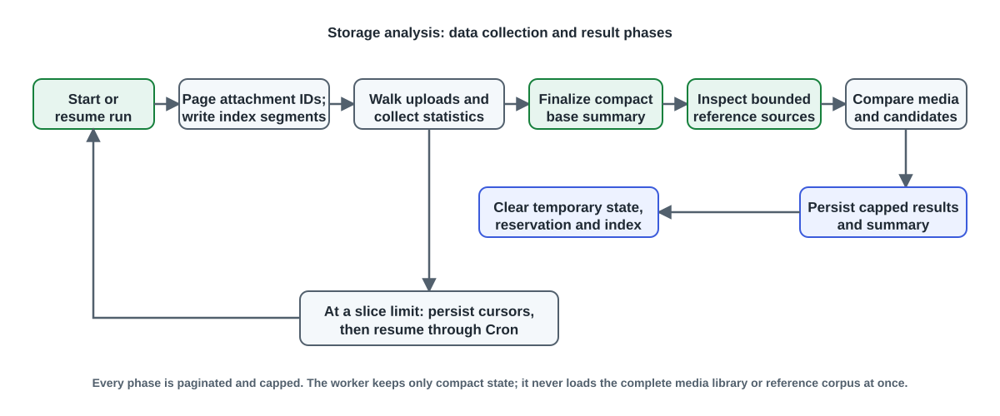
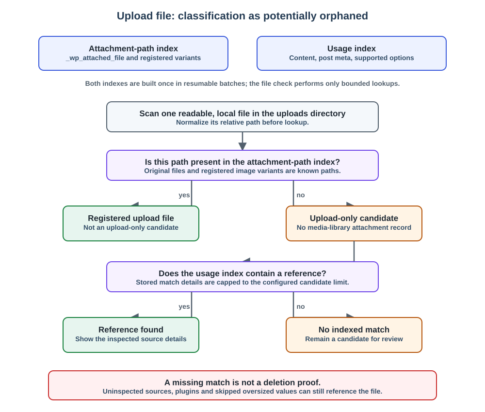
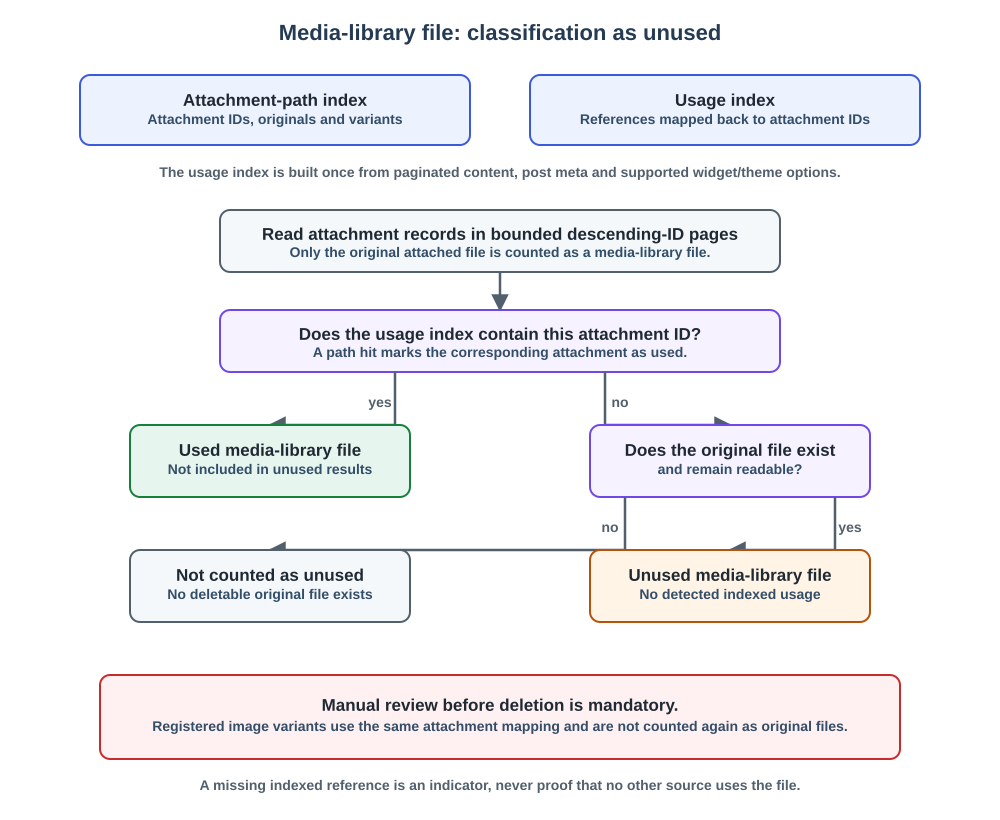

# Storage analysis

## Purpose

Storage analysis examines the uploads directory and media library of one site. It is available in Multisite Manager and, with local permission, under **Media > Storage analysis** on the respective site.

## Areas

* **Analysis:** storage consumption, file types, largest files and directories, and potentially orphaned files.
* **Missing metadata:** media and files for which expected metadata is incomplete. Hover actions lead to media-file details and editing in the respective media library.
* **Media-file details:** technical data for a file, preview, link to edit it in the source site, and an optional TinEye reverse image search for images.

The displayed difference between the previously measured storage value and the found upload volume is shown directly next to the found storage size.

## Execution

Small sites with a known size can be examined in bounded browser batches. An unknown size requires background analysis, so the browser cannot accidentally start a large scan. Large sites are processed exclusively by resumable background tasks. Analysis progresses through upload structure, media index, metadata, and, where applicable, reference checks; it does not attempt to process tens of thousands of files in one request.

Each scheduled invocation keeps processing within a five-second soft budget and its memory budget, with a 1,000-step emergency cap, then persists the phase and resumes through the central continuation queue. Only one queue event resumes one website at a time; old run IDs cannot restart a completed analysis. The configured runtime limit counts active processing time, excluding Cron waiting time. A run also expires after seven days. Blocking database/filesystem operations can exceed the soft budget; server timeouts still apply.

Scheduled storage analyses are configured in **Settings > Monitoring**. Depending on media count and measured active execution time, a site is assigned to one of three independent profiles: small shared batch, medium shared batch, or an individual task. A site moves up when its media count **or** its last successful active runtime exceeds a profile threshold: by default up to 250 media and 5 seconds for the small batch, up to 1,500 media and 120 seconds for the medium batch, otherwise an individual task. Cron waiting time is not included. Each profile has its own cycle and active-runtime limit; individual tasks permit up to twelve hours. Contradictory thresholds are normalized so medium thresholds cannot be lower than the corresponding small thresholds.

An aborted or failed site in a collective batch can be restarted from its monitoring row. This schedules one targeted run through the existing batch hook; it does not restart the collective pass or change other sites' assignments. The recurring batch schedule remains in place.

## How files are classified

The orphan check first builds two bounded indexes: an attachment-path index from media-library records and a usage index from inspected references. The resulting paths and attachment IDs are compared in two separate branches. An upload file with no attachment-path entry is a **potentially orphaned upload file**. A media-library attachment whose original file exists but whose attachment ID has no indexed usage is an **unused media-library file**. The latter check counts original files only; registered image variants are mapped through the same attachment index and are not counted again.

For performance, the usage index is built once from paginated post content, post meta and the supported widget/theme options. The scan does not issue a database `LIKE` query for every file. Only a capped number of the largest upload-only candidates receives stored match details. A reference match explains where the file was found; no match, an uninspected source, or an intentionally skipped oversized value never proves that deletion is safe.

## Caution with orphaned files

A potentially orphaned file is not automatically unused. References may exist in themes, plugins, widgets, block attributes, or unexamined meta fields. Deletion actions are therefore individually protected and should happen only after subject-matter review.

## Implementation and persistence

`Dashboard::renderSiteStorageAnalysisPage()` uses `StorageAnalysisService`, `StorageAnalysisStateService`, and `StorageAnalysisResultService`. The template is `templates/site-storage-analysis-page.php`; a file's detail view uses `templates/site-storage-attachment-debug.php`.

The persistent result is stored per site in the non-autoloaded options `rrze_msm_site_storage_analysis_result`, `rrze_msm_site_storage_analysis_result_meta`, and `rrze_msm_site_media_metadata_analysis_result`. Running process data is held in stable, format-versioned network transients that survive detail-cache invalidation; [Runtime state and scheduler](runtime-state.md#storage-analysis) lists complete key patterns, Cron hooks, scheduler options, and locks.

The analysis uses fixed sub-limits: 250 upload entries, 50 metadata entries, ten files per orphan-check step, and at most 500 stored metadata-result rows. The attachment-index page size and the number of index segments written per step are configurable separately under **Settings > Monitoring** for all three profiles. Defaults are 25 attachments and 16 segments for small shared batches, 35 and 20 for medium shared batches, and 50 and 24 for individual runs. The selected values are stored in the active state so that a configuration change does not alter an in-progress analysis. Index input paths are limited to 1,024 bytes, attachment metadata to 256 KiB and variants to 256 per attachment. The in-process index cache keeps at most 32 hash buckets, each under the segment cap. Exceeding an index input limit stops analysis explicitly; registered files must never become orphan candidates because index entries were silently omitted. Metadata listings read bounded titles and metadata and determine text-field presence in SQL instead of loading complete descriptions into Core caches.

The orphan check builds a site-local reference index once, in resumable source batches, before classifying candidates. It examines bounded post content, post metadata, and the supported widget/theme options; individual values larger than 256 KiB are not parsed. Post-meta references are paginated by post and meta cursor, avoiding a full result set in memory. Candidate checks then use this index rather than running a SQL `LIKE` query for every file. A missing indexed reference remains an indicator for manual review, never proof that a file can be deleted safely.

Files without a media-library attachment record and registered attachments without detected usage are separate results. The orphan check rebuilds the bounded attachment path index, scans the supported reference sources once, then visits attachment records in descending ID order in pages of 50. It counts all unused original attachment files and stores at most 250 recent detail rows (or the lower configured orphan limit). Image variants are checked for references through the attachment path index but are not counted again as original files. The media-library table links to the attachment for manual review; it does not offer direct deletion because uninspected sources may still use the file.

Each persistent storage or metadata result is capped at 2 MiB of PHP-serialized data, summary metadata at 16 KiB. Compaction bounds every variable list and string before serialization and preserves scalar totals and progress. Shortened details are indicated in the UI. Oversized identifiers are cleared rather than shortened into another actionable path. Database write failures are reported. For 800 sites, the two result types can still occupy up to 3.125 GiB plus summaries and database overhead; these caps are safety limits, not expected usage.

Legacy oversized derived results are size-gated in SQL before reading: their verbose details are replaced by a bounded reanalysis notice, preserving any available bounded storage summary. Original media and content remain intact. Reading a result or the bounded maintenance traversal performs this repair; details require a new analysis.

Attachment statistics are accumulated from paginated media-index segments before the file scan. Shared physical paths are deduplicated across attachments. Finalization uses that compact summary and does not reload the entire media library. Media-file debugging reads only the selected attachment and its metadata.

Index construction writes at most 16 segments per step under one shared budget lock. Each segment has a hard serialized limit of 128 KiB, the complete temporary index 32 MiB per site, and each working state 1 MiB. The group is size-checked and reserved before writing; an interrupted group remains in the saved pending state and is replayed idempotently. An absent expected segment stops analysis to prevent incorrect orphan classifications. The plugin retains at most 32 hash buckets in its own PHP cache, allowing filesystem lookups to reuse recently read segments without retaining an unbounded index. In-process WordPress copies are evicted for database-backed transients; external caches supporting `flush_runtime` are periodically cleared only in memory, preserving persistent cache contents. Four temporary indexes and four active storage/metadata workers are admitted network-wide by default; saved settings are clamped to a hard maximum of eight. These limits cover browser and background analysis. At the hard limit, temporary-index payload is bounded to 256 MiB plus base/orphan state, excluding database/cache overhead, WordPress runtime memory and previous legacy data awaiting cleanup. The limits do not reserve physical RAM.

Base/orphan states and idle reservations expire after 24 hours; index segments have a seven-day TTL but idle reservation cleanup removes them after 24 hours. Completion, restart and handled failure clear temporary state. Hourly maintenance is scheduled only after analysis activity, never during activation. It removes expired/obsolete runtime keys in batches of 250 timeout keys without reading payloads, and repairs oversized results for 25 sites per invocation. Active analyses continue through the central Cron queue after about one second. An individual analysis waiting for network-wide capacity instead retries on its own site's Cron after about one minute; maintenance pauses may also delay a continuation by at least one minute. With an external Cron service, actual execution follows its cadence rather than the nominal one-second delay.

Worker admission uses atomic main-site options and tokens. Expired worker leases are reclaimed only when local process termination can be verified, or a later non-threaded request reuses the same PID with no live callback token. An unverified remote worker remains reserved and is logged after 24 hours. Operators must verify it has stopped before clearing such a reservation. Server-enforced PHP-FPM and database/filesystem timeouts remain necessary: the five-second budget is checked between steps and cannot interrupt a blocking operation.

Administrative pages never call `get_space_used()` to recalculate usage. They prefer the compact last analysis measurement, fall back to an existing Core `dirsize_cache` entry, and show unknown when neither is available. Measured values are labelled as the last measurement. Unknown sites prevent a misleading free-capacity chart or utilization percentage for the network.
